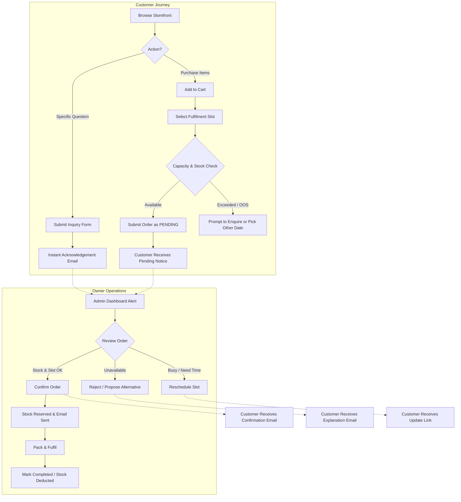
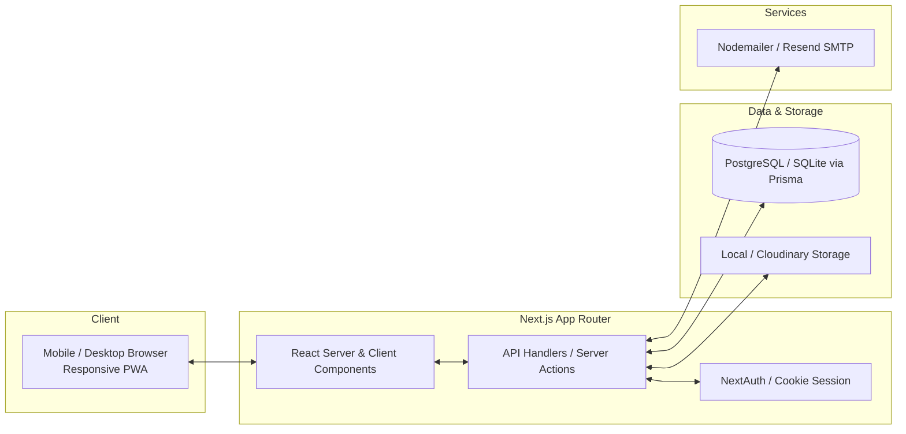
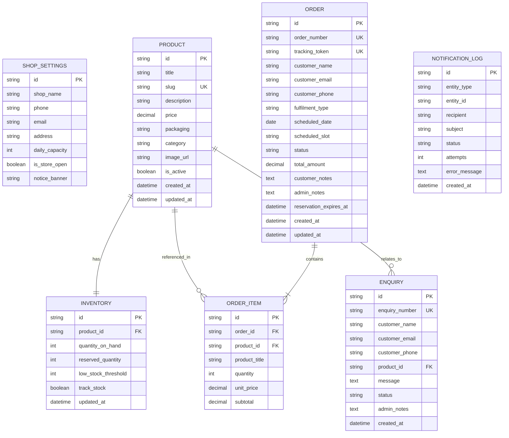
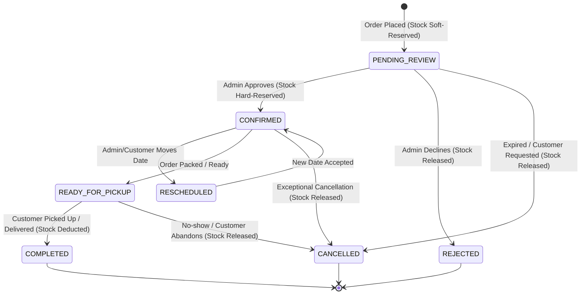
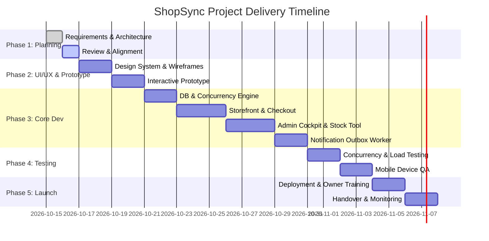

# ShopSync — System Architecture & Product Requirements Document (Phase 1)
> **"Your Shop. Online. In Control."**  
> *A balanced, resilient digital storefront and operational cockpit designed for independent neighbourhood shops.*

---

## Executive Summary & Context

ShopSync addresses a specific operational tipping point: a neighbourhood merchant who has successfully attracted customer interest online, but is overwhelmed by unstructured inquiries across chat apps, inaccurate stock expectations, and peak-volume orders exceeding fulfilment capability.

The primary objective is not merely an e-commerce catalog; it is an **operational control center** that harmonizes customer-facing availability with shop-floor reality, preventing overselling, throttling order intake within manageable daily capacity, and streamlining communications without requiring technical expertise or high operating costs.

---

## 1. User Roles & Permissions Matrix

### 1.1 Shop Owner / Admin
The owner manages store settings, inventory, inquiries, and the order lifecycle from any desktop or mobile browser.

| Capability | Allowed | Disallowed / Guardrails |
| :--- | :---: | :--- |
| **Catalog Management** | ✅ | Cannot delete products with historical order records (soft-delete / archive only). |
| **Stock Adjustments** | ✅ | Audit trail records timestamp and quantity delta for every manual override. |
| **Capacity Configuration**| ✅ | Changing capacity does not retrospectively invalidate already confirmed orders. |
| **Order Processing** | ✅ | Cannot confirm an order if available stock < ordered quantity. |
| **Inquiry Management** | ✅ | Converting an inquiry to an order requires explicit customer item/date confirmation. |
| **Notification Settings** | ✅ | Cannot bypass email logging; system preserves all dispatch attempts. |

### 1.2 Customer (Shopper / Enquirer)
Customers browse products, check real-time availability, submit inquiries, and place orders with scheduled pickup/delivery slots without needing complex account onboarding.

| Capability | Allowed | Disallowed / Guardrails |
| :--- | :---: | :--- |
| **Browsing & Search** | ✅ | Cannot view unpublished/draft products, internal margins, or wholesale notes. |
| **Placing Orders** | ✅ | Cannot place orders beyond remaining stock or on days where capacity is closed. |
| **Order Tracking** | ✅ | Can only view their own order status via a secure, unguessable token link. |
| **Inquiries** | ✅ | Rate-limited to prevent form spam; cannot directly alter database stock. |
| **Cancellation** | ✅ | Can request cancellation only while order is in `PENDING_REVIEW` status. |

---

## 2. End-to-End User Workflows



### 2.1 Adding and Updating Products
1. **Input**: Title, category, price, packaging details (e.g., "500g tray", "Pack of 6", "1 Litre glass bottle"), description, product image, and initial stock count.
2. **Validation**: Non-negative prices and counts; image optimization check (automatic compression on upload).
3. **Visibility**: State toggle (`Active`, `Draft`, `Hidden`).
4. **Outcome**: Immediately indexed in the storefront search and category filters.

### 2.2 Changing Stock Availability (Rapid Shop-Floor Mode)
- **Quick-Toggle**: A one-tap toggle on the admin mobile dashboard to mark any item `Out of Stock` or `Back in Stock` instantly without opening full edit forms.
- **Stock Delta**: Quick `+1`, `+5`, `-1`, `-5` buttons for fast physical shelf reconciling.
- **Low-Stock Alerting**: Visual amber tag when stock drops below configured threshold (e.g., $\le 3$ units).

### 2.3 Browsing & Cart Construction
- **Transparent Stock Labels**:
  - `In Stock` (Green)
  - `Low Stock — X units remaining` (Amber)
  - `Sold Out` (Muted gray — order button disabled, replaced with "Enquire about restock")
- **Packaging Visibility**: Clear unit indicators so customers know packaging dimensions and quantities before buying.

### 2.4 Submitting an Inquiry
- **Contextual Inquiries**: Inquiry modal pre-populates the product name and current price if launched from a product card.
- **Verification**: Lightweight honeypot and time-based anti-bot protection.
- **Receipt**: Customer receives an automated email within seconds confirming their query was received with an expected response window (e.g., "within 4 business hours").

### 2.5 Order Placement & Capacity Check
1. Customer enters contact details (Name, Phone, Email) and selects **Fulfilment Method** (Store Pickup vs Local Delivery).
2. Customer selects a target **Date & Time Window**.
3. **Pre-check**: The system queries active orders for that date. If the daily capacity cap is reached, the date is blocked with a friendly notification: *"Fulfilment capacity full for this day. Please select tomorrow or send us an enquiry."*
4. Order is saved with initial status `PENDING_REVIEW`.

### 2.6 Order Triage (Confirm, Reject, Reschedule)
- **Confirm**: System converts temporary reservation into hard reservation. Email dispatch triggers with pickup instructions / delivery window.
- **Reject**: Admin provides a canned or custom reason (e.g., "Damaged batch during morning intake"). Stock reservation released immediately. Email dispatched.
- **Reschedule**: Admin selects an alternate available date/slot. Customer receives a notice with an "Accept" or "Cancel" response option.

### 2.7 Order Completion
- When the customer collects the order or delivery is marked done:
  - Admin clicks **Mark Completed**.
  - Reserved stock is formally decremented from `quantity_on_hand`.
  - Transaction log is permanently closed.

---

## 3. Essential Business Rules & Boundary Conditions

### 3.1 Strict Separation of Inquiries vs Orders
- **Rule**: An enquiry **never** holds inventory and **never** decrements stock.
- **Enquiry Conversion**: If an inquiry leads to a sale, the owner uses a 1-click action: "Generate Draft Order from Inquiry", which re-validates stock before creating an actual order.

### 3.2 Inventory Concurrency & Race Condition Elimination
- **Challenge**: Two customers checkout the last available unit of "Organic Honey (500g)" simultaneously.
- **Rule**: 
  - Stock validation occurs at database write-time using an atomic decrement/conditional update:
    $$\text{UPDATE Inventory SET reserved = reserved + Qty WHERE product\_id = :id AND (on\_hand - reserved) } \ge \text{Qty}$$
  - If the database query returns 0 rows affected, the second checkout is rejected gracefully: *"Apologies! Another customer completed their order a few seconds prior. This item is now sold out."*
- **Reservation Window**: Pending orders hold stock for a maximum of **120 minutes** (configurable). If the owner neither confirms nor rejects the order within that time, or if payment/pickup verification fails, the reservation expires automatically to prevent inventory locking.

### 3.3 Daily Capacity Throttling
- **Rule**: Every day has a hard limit: $\text{Capacity}_{\text{max}}$.
- Active order count includes: $\text{Count}(\text{PENDING\_REVIEW}) + \text{Count}(\text{CONFIRMED})$.
- When $\text{Active} \ge \text{Capacity}_{\text{max}}$, the checkout interface disables that date immediately.
- Customers attempting to order for that date are shown: *"We have reached our daily order limit to maintain quality service. Would you like to submit an enquiry or choose another date?"*

### 3.4 Outbox Resilience for Notification Failures
- **Rule**: Order and enquiry state changes **must never depend synchronously** on third-party email delivery.
- All email dispatches write an entry to an internal `notification_queue` table with status `QUEUED`.
- A background worker attempts dispatch. If the SMTP server is down or rejects the request, the order remains safely stored, and the message status is updated to `FAILED` with retry counters.
- Admin dashboard displays an alert if notification failures occur.

### 3.5 Real-Time Transparency vs Stale Data
- Any inventory count unverified for longer than 7 days (or flagged by the owner as "uncounted") displays a badge: *"Available — Subject to Confirmation"* rather than an absolute guaranteed unit count.

---

## 4. Clarification Questions for Implementation

To tailor the build precisely to the owner's operational setup, the following 4 decisions should be aligned:

1. **Fulfilment Logistics**: Does the shop offer both In-Store Pickup and Local Delivery, or In-Store Pickup only for the MVP? (Pickup-only eliminates delivery address validation and zone calculations).
2. **Customer Payment Terms**: Will customers pay offline on collection/delivery (Cash, Card on POS, UPI/Bank Transfer), or is an integrated online payment gateway strictly required for MVP? *(Recommendation: Offline payment on pickup keeps operational complexity low, avoids transaction fees, and simplifies refunds for out-of-stock items).*
3. **Customer Accounts vs Frictionless Guest Checkout**: Should customers have login credentials, or should checkout be guest-only with magic tracking URLs sent via SMS/Email? *(Recommendation: Guest checkout with secure tracking token maximizes conversion).*
4. **Capacity Metric**: Is capacity measured strictly by total order count per day (e.g., 20 orders/day) or by order value/item quantity? *(Recommendation: Fixed order count per day).*

---

## 5. Scope Definition: MVP vs Future Enhancements

```
┌────────────────────────────────────────────────────────┐
│                      PHASE 1 MVP                       │
│  • Public Storefront with responsive catalog           │
│  • Packaging details & live stock badges               │
│  • Cart & Guest Checkout with slot booking             │
│  • Daily capacity throttling & atomic reservation      │
│  • Dedicated Inquiry Form (general + product specific) │
│  • Mobile-friendly Admin Dashboard                     │
│  • Quick Stock Toggle (+/- & Out of Stock)             │
│  • Resilient Notification Outbox (Email dispatch)      │
│  • Order Status Tracking via unique token links        │
└────────────────────────────────────────────────────────┘
                           │
                           ▼
┌────────────────────────────────────────────────────────┐
│                   FUTURE EXTENSIONS                    │
│  • Online Payment Gateways (Stripe / Razorpay)         │
│  • WhatsApp Business API notifications (Twilio/Meta)   │
│  • Customer Accounts with Order History & Favorites    │
│  • Barcode / QR-code scanning for rapid inventory      │
│  • Multi-user role hierarchy (Cashier vs Owner)        │
│  • Delivery Driver dispatching & route grouping        │
│  • Multi-language storefront support                   │
└────────────────────────────────────────────────────────┘
```

---

## 6. Recommended Technology Stack

We select a modern, cohesive, lightweight stack designed for maximum reliability, zero runtime hosting costs on free/starter tiers, minimal maintenance, and straightforward local development.



### Detailed Layer Breakdown

| Component | Technology | Rationale & Trade-offs |
| :--- | :--- | :--- |
| **Full-Stack Framework** | **Next.js (App Router, TypeScript)** | Single codebase for frontend UI and backend API routes. Eliminates CORS issues, simplifies deployment, and provides blazing fast Server-Side Rendering (SSR) for product SEO. |
| **Styling & Design System** | **Tailwind CSS + Lucide Icons** | Ultra-responsive, mobile-first utility styling. Provides accessible, modern components with zero runtime overhead and clean aesthetics. |
| **Database & ORM** | **SQLite (Dev) / PostgreSQL (Prod) via Prisma ORM** | Prisma provides type-safe queries, automatic migrations, and schema modeling. SQLite allows instant zero-setup local runs; PostgreSQL (via free tiers like Supabase or Neon) enables reliable cloud production. |
| **Authentication** | **Auth.js / NextAuth (Credentials + Secure Session Cookie)** | Password hashing via `bcryptjs`. Minimal footprint; only the shop owner requires login. Customers use token-based URLs. No costly third-party auth service required. |
| **Email Service** | **Nodemailer with SMTP Outbox** | Compatible with standard Gmail App Passwords, Brevo (300 free emails/day), or Resend (100 free emails/day). Backed by an in-database queue for guaranteed resilience. |
| **Hosting & Deployment** | **Vercel / Render / Node VPS** | Zero cost on hobby tiers. Can be containerized via Docker for self-hosting on any standard VPS ($3-$5/mo) if preferred. |

---

## 7. Relational Data Model & State Transitions

### 7.1 Entity-Relationship (ER) Diagram



### 7.2 Order Status State Machine



### 7.3 Inventory Calculation Formalism
At any given moment, for any product $i$:
$$\text{Available Stock}_i = \text{Max}(0, \, \text{quantity\_on\_hand}_i - \text{reserved\_quantity}_i)$$

1. **When Order placed (`PENDING_REVIEW`)**:
   $$\text{reserved\_quantity} \leftarrow \text{reserved\_quantity} + Qty$$
2. **When Order rejected or cancelled (`REJECTED` / `CANCELLED`)**:
   $$\text{reserved\_quantity} \leftarrow \text{reserved\_quantity} - Qty$$
3. **When Order fulfilled (`COMPLETED`)**:
   $$\text{quantity\_on\_hand} \leftarrow \text{quantity\_on\_hand} - Qty$$
   $$\text{reserved\_quantity} \leftarrow \text{reserved\_quantity} - Qty$$

---

## 8. Testable Acceptance Criteria (Gherkin Format)

### Scenario 1: Preventing Overselling on Simultaneous Checkouts
```gherkin
Given product "Organic Honey 500g" has quantity_on_hand = 1 and reserved_quantity = 0
When Customer A and Customer B both submit orders for 1 unit at the exact same second
Then the database atomic lock allows Customer A's order to succeed with status "PENDING_REVIEW"
And Customer A's order reserves 1 unit (available stock becomes 0)
And Customer B's order fails with message "Sorry, this item was just claimed by another customer"
And no negative stock occurs.
```

### Scenario 2: Enforcing Daily Fulfilment Capacity
```gherkin
Given the daily capacity for "2026-10-20" is set to 15 orders
And there are already 15 active orders scheduled for that date
When a customer attempts to select "2026-10-20" during checkout
Then the date is visibly disabled and marked "Capacity Reached"
And the customer is given the option to choose another date or click "Enquire for this date"
And the system rejects any direct POST request targeting the full date with an HTTP 409 Conflict.
```

### Scenario 3: Email Notification Failure Fault-Tolerance
```gherkin
Given the shop's SMTP server is temporarily unreachable
When a customer submits a valid enquiry form
Then the enquiry record is successfully saved in the database with status "RECEIVED"
And an entry in notification_log is created with status "QUEUED"
And the customer is immediately displayed the confirmation screen "Thank you! Your enquiry has been received."
And the background worker marks the notification as "FAILED" with error details after timeout
And the enquiry remains accessible on the owner's dashboard without data loss.
```

### Scenario 4: Transparent Public Statuses
```gherkin
Given Customer A has placed order "ORD-1042"
When Customer A navigates to their unique tracking link "/order/ORD-1042?token=xyz987"
Then they see the exact real-time status "Pending Confirmation by Shop"
And when the owner clicks "Confirm Order" in the admin portal
And Customer A refreshes their page
Then the status updates immediately to "Confirmed — Ready for Pickup on 2026-10-18 at 2:00 PM"
And no ambiguous or conflicting statuses are displayed.
```

### Scenario 5: Shop Owner Rapid Stock Control
```gherkin
Given the owner is viewing the Admin Inventory page on a mobile device
When the owner taps the "Quick Out of Stock" toggle next to "Sourdough Bread"
Then the item immediately updates to available = 0 in less than 500ms
And the public storefront updates on next visit to show "Sold Out"
And any existing in-flight carts attempting to checkout that item are notified before order creation.
```

---

## 9. Proposed Project Structure

```
ShopSync/
├── docs/
│   ├── ARCHITECTURE.md
│   └── PHASE_1_PLANNING_AND_REQUIREMENTS.md
├── prisma/
│   ├── schema.prisma              # Database schema & relationships
│   └── seed.ts                    # Sample neighborhood grocery data
├── public/
│   ├── images/                    # Local product image assets
│   └── favicon.ico
├── src/
│   ├── app/                       # Next.js App Router
│   │   ├── (storefront)/          # Public-facing layout
│   │   │   ├── page.tsx           # Home / Catalog browsing
│   │   │   ├── product/[slug]/    # Product details & packaging
│   │   │   ├── cart/              # Cart & slot checkout
│   │   │   ├── enquiry/           # Customer enquiry form
│   │   │   └── order/[id]/        # Order tracking via secure token
│   │   ├── (admin)/               # Protected Admin layout
│   │   │   ├── admin/login/       # Owner authentication
│   │   │   ├── admin/dashboard/   # Metrics & fast overview
│   │   │   ├── admin/products/    # Product catalog & quick stock
│   │   │   ├── admin/orders/      # Order processing & triage
│   │   │   ├── admin/enquiries/   # Enquiry inbox & replies
│   │   │   └── admin/settings/    # Daily capacity & hours
│   │   └── api/                   # Server endpoints
│   │       ├── checkout/          # Atomic order submission
│   │       ├── enquiries/         # Anti-spam inquiry submission
│   │       └── cron/              # Reservation cleanup & email retry
│   ├── components/                # Reusable UI components
│   │   ├── ui/                    # Buttons, modals, badges, inputs
│   │   ├── storefront/            # Product cards, slot picker, navbar
│   │   └── admin/                 # Quick-toggle, order card, metric cards
│   ├── lib/                       # Core utilities & services
│   │   ├── db.ts                  # Prisma client instance
│   │   ├── auth.ts                # NextAuth session configuration
│   │   ├── mailer.ts              # Resilient SMTP outbox dispatcher
│   │   ├── inventory.ts           # Concurrency-safe stock math
│   │   └── capacity.ts            # Daily slot & order limit validator
│   └── types/                     # Shared TypeScript interfaces
├── .env.example                   # Environment variable template
├── package.json
├── tailwind.config.js
└── tsconfig.json
```

---

## 10. Five-Phase Implementation Roadmap



### Detailed Phase Milestones

#### Phase 1: Planning and Requirements (Current)
- **Deliverables**: Comprehensive requirements document, entity diagrams, business rules, concurrency specifications, roadmap.
- **Dependencies**: Stakeholder review and sign-off.
- **Completion Criteria**: Explicit approval from owner/lead on scope, decisions, and stack.

#### Phase 2: UI/UX Design and Prototype
- **Deliverables**: 
  - Visual design tokens (colors, typography, spacing, glassmorphic accents).
  - High-fidelity interactive prototype for Storefront (Catalog, Packaging detail, Slot selector).
  - Admin Cockpit wireframes designed specifically for mobile 1-hand thumb interactions.
- **Dependencies**: Approved requirements from Phase 1.
- **Completion Criteria**: Complete click-through demo verified on mobile and desktop viewports.

#### Phase 3: Core Development
- **Deliverables**:
  - Prisma schema, SQLite/PostgreSQL setup, and seed data.
  - Concurrency-safe checkout with atomic inventory reservation and daily capacity limiter.
  - Storefront catalog with real-time stock indicators and category filters.
  - Enquiry system with spam protection and automated acknowledgement dispatch.
  - Admin dashboard with quick-stock toggles, order status management, and capacity settings.
  - Resilient email outbox with automatic retry handling.
- **Dependencies**: Prototype approval from Phase 2.
- **Completion Criteria**: All end-to-end workflows (Browse → Order → Confirm → Complete) functional without errors.

#### Phase 4: Testing and Refinement
- **Deliverables**:
  - Automated concurrency test suite simulating simultaneous checkouts on remaining inventory.
  - Capacity boundary test verifying slot closure when threshold is met.
  - Network interruption and SMTP-failure recovery verification.
  - Cross-browser and responsive mobile testing on iOS and Android.
  - Lighthouse performance audit score ≥ 90 for SEO and speed.
- **Dependencies**: Codebase complete from Phase 3.
- **Completion Criteria**: Zero race conditions, zero data loss during simulated email failures, sub-second page loads.

#### Phase 5: Launch and Support
- **Deliverables**:
  - Production deployment setup (Vercel / Render / VPS) with automated SSL.
  - Initial catalog population and owner training guide (1-page cheat sheet).
  - Automated daily database backup routine.
  - 14-day post-launch operational support and bug triage.
- **Dependencies**: Signed-off testing results from Phase 4.
- **Completion Criteria**: The shop owner successfully manages live daily orders and inquiries independently from their phone.

---
*End of Phase 1 Specification.*
