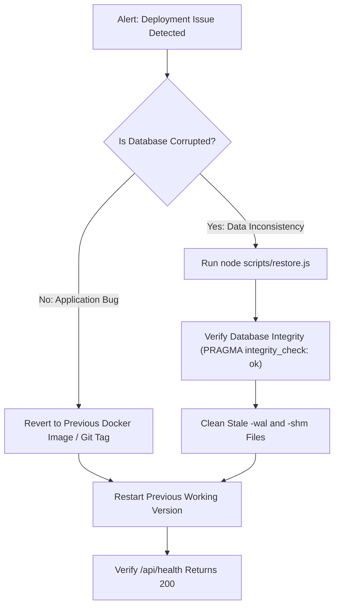

# ShopSync — Phase 5: Launch Planning & Support Readiness Plan

**Document Version:** 1.0.0  
**Phase:** Phase 5 (Launch Planning, Staging Assessment & Support Readiness)  
**Date:** October 16, 2026  
**Status:** Prepared & Awaiting Owner Approval  
**Author:** Antigravity Senior Product Designer, Software Architect & Full-Stack Engineer  

---

## 1. Executive Summary & Objective

The objective of Phase 5 is to establish a comprehensive deployment strategy, staging-readiness assessment, operational maintenance plan, and owner support framework for **ShopSync — Your Shop. Online. In Control.**

### Operational Boundaries:
- **Zero Premature Deployment:** No public cloud resources, domain DNS records, or paid services have been provisioned or purchased.
- **Codebase Preservation:** All existing business logic, inventory invariants, database schemas, and artisanal green-and-cream design tokens are strictly preserved without rebuilding or replacing the application.
- **Data Integrity:** Only synthetic test data is used; no real customer information is migrated or exposed.

---

## 2. Technical Stack Audit & Compatibility Assessment

### Verified Compatibility (Tested on Host System):
1. **Node.js Runtime Requirement:**
   - **Host Runtime:** Node.js `v24.21.0`.
   - **Minimum Engine:** `node >= 22.5.0` (Active LTS).
   - **Reason:** Built-in `node:sqlite` (`DatabaseSync`) was introduced in Node.js 22.5.0, eliminating third-party native compilation toolchains (e.g., `node-gyp`, Python, C++ compiler) in production.
2. **Database Engine & Persistence:**
   - **Active Implementation:** Embedded SQLite (`data/shopsync.db`) configured with Write-Ahead Logging (`PRAGMA journal_mode = WAL;`) and synchronous normal mode (`PRAGMA synchronous = NORMAL;`).
   - **Concurrency:** Immediate write transactions (`runTransaction`) and busy timeouts (`PRAGMA busy_timeout = 5000;`) safely handle concurrent reads and serialized writes.
   - **Durability Across Restarts:** Verified in test Suite 17; database records persist across application lifecycles and process restarts.
3. **Abuse Protection & Rate Limiting:**
   - **Implementation:** SQLite-backed rate limiter (`rate_limits` table in `data/shopsync.db`), enforcing atomic window limits with standard `Retry-After` headers.
   - **Process Safety:** Operates safely across multi-process Node.js clusters on the same host sharing the SQLite database.
4. **Session Authentication & CSRF:**
   - **Authentication:** HMAC-SHA256 signed session tokens stored in hardened `HttpOnly`, `SameSite=lax` cookies.
   - **CSRF Defense:** Same-Origin header verification on all state-changing mutations (`POST`, `PATCH`, `PUT`, `DELETE`).
5. **Live Crash-Consistent Backup & Restore:**
   - **Backup (`scripts/backup.js`):** Uses SQLite native `VACUUM INTO`, which safely checkpoints WAL pages into a standalone, verified database file without locking out live traffic.
   - **Restore (`scripts/restore.js`):** Enforces 4-step safety: pre-restore integrity check, emergency `.prerestore.bak` rollback copy, WAL/SHM sidecar cleanup, and post-restore verification.
6. **System Health Probe:**
   - **Route:** `GET /api/health` returns HTTP 200 with database connection status, quick check verification, latency in milliseconds, process uptime, and Node.js version.

### Technical Limitations & Assumptions (Requiring Explicit Architectural Strategy):
- **Single-Writer SQLite Scope:** The embedded SQLite database supports serialized writes on a single host. For a neighbourhood shop handling up to several hundred orders and enquiries per day, performance is instantaneous (< 10ms latency).
- **Multi-Server Limitation:** The SQLite database and rate limiter require a shared POSIX filesystem. Deploying across multiple distinct servers in a stateless horizontally autoscaling cluster without shared volume storage would cause database split-brain. A single-instance persistent container or VPS architecture is therefore required.

---

## 3. Recommended Hosting Architectures & Trade-Off Analysis

We evaluated the four primary hosting options against the project's SQLite WAL persistence, Node.js 22+ requirement, and budget constraints:

| Hosting Option | Storage Persistence | Node.js 22+ & `node:sqlite` | Setup & Maintenance Overhead | Estimated Monthly Cost | Recommendation Status |
|---|:---:|:---:|:---:|:---:|:---:|
| **Option A: Single-Instance PaaS with Persistent Disk** (Railway / Fly.io / Render) | ✅ **Yes** (Dedicated persistent volume mount `/app/data`) | ✅ **Yes** (Runs standard Dockerfile on Node.js 22 LTS) | **Low** (Zero Linux sysadmin; automated git-push deploys & auto-HTTPS) | ~$5 – $10 / month | **PRIMARY RECOMMENDATION (Simplest for Small Business)** |
| **Option B: Dedicated Linux VPS** (Hetzner Cloud / DigitalOcean / Linode) | ✅ **Yes** (Direct NVMe filesystem persistence) | ✅ **Yes** (Native Node 22/24 package via NodeSource) | **Medium** (Requires initial Linux setup: Caddy reverse proxy + PM2/Systemd) | ~$3.50 – $6 / month | **STRONGLY RECOMMENDED (Most Cost-Effective & Resilient)** |
| **Option C: Serverless / Ephemeral Lambdas** (Vercel / Netlify / AWS Lambda) | ❌ **No** (Ephemeral `/tmp`, destroyed between cold starts) | ⚠️ Partial (Lambda cold start limitations) | **High** (Would require complete rewrite to external Postgres + Redis) | $0 – $25+ / month | ❌ **INCOMPATIBLE WITH SHOPSYNC ARCHITECTURE** |
| **Option D: In-Shop Mini PC** (Raspberry Pi 5 / Intel N100 + Cloudflare Tunnel) | ✅ **Yes** (Local SSD storage) | ✅ **Yes** (Linux Node.js runtime) | **High** (Vulnerable to home broadband dropouts and power cuts) | $0 / month (Hardware cost ~$80) | **RESERVED AS LOCAL DEV / BACKUP NODE ONLY** |

---

### In-Depth Hosting Breakdown:

#### Option A: Single-Instance Container PaaS (Railway or Fly.io) — *Easiest Maintenance*
- **Why it fits:** Provides an isolated container running our production `Dockerfile` with a persistent volume mounted at `/app/data`.
- **How it works:**
  1. Container volume mounted to `/app/data` ensures `shopsync.db`, `shopsync.db-wal`, and `data/backups/` survive container restarts and code updates.
  2. Built-in reverse proxy provides automatic Let's Encrypt SSL/TLS certificates and automated domain routing.
  3. Continuous health monitoring queries `GET /api/health` every 30 seconds.
- **Cost:** ~$5/month (Railway: $5 includes 1GB RAM container + 1GB volume; Fly.io: ~$3–$5/month).

#### Option B: Dedicated Linux VPS (Hetzner Cloud CX22 or DigitalOcean Droplet) — *Maximum Ownership & Best Value*
- **Why it fits:** Unmatched raw NVMe disk performance for SQLite WAL operations, complete control over cron backups, and zero PaaS vendor lock-in.
- **How it works:**
  1. Ubuntu 24.04 LTS server with Node.js 22 LTS installed.
  2. Systemd service ([`deploy/shopsync.service.example`](file:///e:/COLLEGE/MY_OWN_PROJECTS/ShopSync/deploy/shopsync.service.example)) supervises the application with automatic restarts.
  3. Caddy web server ([`deploy/Caddyfile.example`](file:///e:/COLLEGE/MY_OWN_PROJECTS/ShopSync/deploy/Caddyfile.example)) manages automatic HTTPS and reverse proxies to `localhost:3000`.
  4. Daily cron job ([`deploy/backup-cron.sh`](file:///e:/COLLEGE/MY_OWN_PROJECTS/ShopSync/deploy/backup-cron.sh)) runs automated backups and rotates snapshots.
- **Cost:** ~€3.79/month (~$4.15/mo) on Hetzner Cloud (2 vCPU, 4GB RAM, 40GB NVMe) or $6/mo on DigitalOcean (1GB RAM, 25GB SSD).

---

## 4. Production Configuration Checklist

### 1. Environment Variables Specification

Before deploying to production, the shopkeeper must configure the following environment variables (stored securely in the host platform or `.env.production`):

| Variable Name | Required | Default / Example Value | Description & Security Guidelines |
|---|:---:|---|---|
| `PORT` | Optional | `3000` | Port on which Next.js listens. |
| `NODE_ENV` | **Required** | `production` | Enforces production optimizations and suppresses development demo helpers. |
| `STRICT_PRODUCTION_SECRETS` | **Required** | `true` | When `true`, the application strictly halts if default passwords or placeholder secrets are detected. |
| `ADMIN_EMAIL` | **Required** | `owner@yourshopdomain.com` | Official shopkeeper login email. Must be kept secure. |
| `ADMIN_PASSWORD` | **Required** | *Cryptographic Passphrase* | Strong, unique admin passphrase. **Never use `shopsync2026` in production.** |
| `SESSION_SECRET` | **Required** | *64-character hex string* | Secret key for HMAC-SHA256 session signatures. Generate with: `node -e "console.log(require('crypto').randomBytes(32).toString('hex'))"` |
| `SMTP_HOST` | **Required for Email** | `smtp.sendgrid.net` (or Mailgun/Postmark/SES) | Outbound SMTP relay hostname. (Omit to run in SIMULATED mode for testing). |
| `SMTP_PORT` | **Required for Email** | `587` | Standard submission port with STARTTLS. |
| `SMTP_USER` | **Required for Email** | `apikey` | SMTP authentication username. |
| `SMTP_PASS` | **Required for Email** | *API Key / Secret* | SMTP authentication password/token. |
| `SMTP_FROM` | **Required for Email** | `"Greenwood Provisions <orders@greenwoodprovisions.com>"` | Authenticated sender identity matching domain SPF/DKIM records. |
| `SMTP_SECURE` | Optional | `false` | `false` for port 587 (STARTTLS), `true` for port 465 (SSL/TLS). |

---

### 2. Store Profile & Catalogue Customization Checklist

The owner must review and tailor the shop defaults before publishing:

```markdown
- [ ] 1. Store Details:
      - Shop Name (e.g. "Greenwood Provisions")
      - Tagline (e.g. "Your Neighbourhood Organic Pantry & Bakery")
      - Physical Address (for customer collection / local pickup)
      - Telephone Number (for customer telephone enquiries)
      - Support Email Address
- [ ] 2. Operational Parameters:
      - Daily Fulfilment Capacity (default: 12 orders/day; set according to owner's daily capacity)
      - Business Hours & Collection Windows (e.g., Morning 9-12, Afternoon 12-3, Evening 3-6)
      - Reservation Hold Duration (default: 120 minutes before unconfirmed reservations auto-release)
      - Currency Symbol (default: "£" GBP; adjust to "$", "€", etc. if applicable)
- [ ] 3. Product Catalogue Setup:
      - Physical stock inventory count on hand for each item
      - Accurate pricing, units, and packaging details
      - High-resolution product photography
      - Allergy, storage, and ingredient details
```

---

## 5. Step-by-Step Staging Deployment Guide

Staging provides a safe, isolated clone where the owner and technical team verify all features without affecting real customers.

### Staging Setup Instructions (Docker or VPS Staging Instance)

#### Step 1: Prepare Staging Directory & Environment
```bash
# 1. Clone repository to staging folder
mkdir -p /var/www/shopsync-staging
cd /var/www/shopsync-staging

# 2. Create staging environment file with synthetic credentials
cat << 'EOF' > .env.staging
PORT=3001
NODE_ENV=production
STRICT_PRODUCTION_SECRETS=true
ADMIN_EMAIL=staging-admin@greenwood.local
ADMIN_PASSWORD=StagingSecurePassphrase2026!#$
SESSION_SECRET=a8f4c2b9e1d7a3f8c5b2e9d4a1f7c3e8a5b2d9f4c1e7a3b8d5f2c9e1a7b4d2f8
EOF
```

#### Step 2: Build & Launch Staging Container
Using our verified multi-stage [`Dockerfile`](file:///e:/COLLEGE/MY_OWN_PROJECTS/ShopSync/Dockerfile) and [`docker-compose.yml`](file:///e:/COLLEGE/MY_OWN_PROJECTS/ShopSync/docker-compose.yml):
```bash
# Build the production image with Node.js 22 LTS
docker build -t shopsync:staging .

# Run staging container on port 3001 with persistent test volume
docker run -d \
  --name shopsync_staging \
  --restart unless-stopped \
  -p 3001:3000 \
  --env-file .env.staging \
  -v $(pwd)/staging_data:/app/data \
  shopsync:staging
```

#### Step 3: Execute Staging Health Check & Verification Matrix
1. **Health Check Probe:**
   ```bash
   curl -s http://localhost:3001/api/health
   # Expected response: {"status":"healthy","database":{"status":"connected","journalMode":"wal","quickCheck":"ok"}}
   ```
2. **Automated Verification Suite:**
   ```bash
   # Run the 22-suite test runner against staging port 3001
   PORT=3001 node scripts/test_workflow.js
   # Expected output: ALL 22 / 22 VERIFICATION SUITES EXECUTED & PASSED!
   ```
3. **Manual Staging Walkthrough:**
   - [ ] Log in at `http://localhost:3001/admin/login` using `staging-admin@greenwood.local`.
   - [ ] Confirm the admin dashboard displays Overview, Orders, Inventory, Enquiries, and Outbox tabs.
   - [ ] Toggle "Pause Order Intake" and verify checkout displays the pause banner while enquiries remain active.
   - [ ] Place a test order for 1 loaf of sourdough bread and track it via the issued tracking token.
   - [ ] Submit a test customer enquiry and verify status progression (`New` ➔ `Contacted` ➔ `Resolved`).
4. **Data Persistence & Restart Rehearsal:**
   ```bash
   # Stop and restart the container
   docker restart shopsync_staging

   # Verify the previously placed test order still exists in the database
   curl -s http://localhost:3001/api/store
   ```
5. **Backup & Restore Rehearsal:**
   ```bash
   # Execute live backup in staging
   docker exec -it shopsync_staging node scripts/backup.js /app/data/backups/staging_rehearsal.db

   # Verify isolated restore
   docker exec -it shopsync_staging node scripts/restore.js /app/data/backups/staging_rehearsal.db /app/data/backups/staging_restore_test.db
   ```

---

## 6. Launch & Rollback Procedures

### Pre-Launch Acceptance Gates (Go / No-Go Decision Matrix)
The site must not be switched live until every gate is passed:

| Gate | Requirement | Responsible Party | Verification Method |
|:---:|---|---|---|
| **1** | Production secrets configured (strong non-default passphrase & 64-char hex session secret) | Technical Lead | Environment inspection (`STRICT_PRODUCTION_SECRETS=true`) |
| **2** | All 22 automated verification suites pass with exit code 0 | Technical Lead | `npm run test` |
| **3** | Clean live database backup created before DNS switch | Technical Lead | `npm run db:backup` |
| **4** | Store contact info, pickup windows, currency, and capacity validated | Shopkeeper | Admin Cockpit review |
| **5** | Product shelf inventory verified against physical store stock | Shopkeeper | Physical shelf count match |
| **6** | Outbound transactional email tested and verified in inbox | Technical Lead & Owner | Test order email received |
| **7** | SSL/TLS certificate active with HTTPS redirect | Technical Lead | Browser padlock verification |

---

### Emergency Rollback Playbook

If a critical issue occurs during deployment (e.g. database migration failure, server crash, network misconfiguration):



#### Step-by-Step Rollback Execution:
1. **Stop Failing Process:**
   ```bash
   systemctl stop shopsync || docker stop shopsync_app
   ```
2. **Restore Verified Database Snapshot:**
   ```bash
   node scripts/restore.js data/backups/shopsync_pre_migration.db data/shopsync.db
   ```
   *(The script automatically creates an emergency pre-restore copy and wipes stale `-wal` and `-shm` sidecars).*
3. **Roll Back Code / Container:**
   ```bash
   # For Docker:
   docker run -d --name shopsync_app -v $(pwd)/data:/app/data --env-file .env.production shopsync:previous_stable

   # For VPS:
   git checkout tags/v1.0.0-stable && npm run build && systemctl start shopsync
   ```
4. **Verify System Restoration:**
   ```bash
   curl -s http://localhost:3000/api/health
   ```

---

## 7. Ongoing Maintenance, Monitoring & Observability

To ensure the shop runs smoothly without technical debt:

1. **Uptime & Health Probing:**
   - Configure a free external monitor (e.g. UptimeRobot, BetterStack, or Cronitor) to ping `https://shop.example.com/api/health` every 60 seconds.
   - Alert the shopkeeper via SMS or email if status is non-200 for more than 2 consecutive checks.
2. **Automated Daily Backups:**
   - Install the provided cron script ([`deploy/backup-cron.sh`](file:///e:/COLLEGE/MY_OWN_PROJECTS/ShopSync/deploy/backup-cron.sh)) to run daily at 03:00 AM.
   - Retain 14 daily snapshots locally and synchronize copies to secure off-site cloud storage (e.g., AWS S3 Glacier or Backblaze B2, cost < $0.05/month).
3. **Outbox Notification Monitoring:**
   - Shopkeeper can view delivery state in the **Admin Outbox** tab.
   - If any email shows `FAILED` status (e.g. due to customer typo or temporary network error), clicking the **"Retry Delivery"** button retries transmission safely without duplicating orders.
4. **Disk & SQLite WAL Monitoring:**
   - Add a weekly check to ensure disk space usage is below 80%.
   - SQLite WAL checkpointing runs automatically; the main database is compacted whenever `npm run db:backup` runs.

---

## 8. Non-Technical Shopkeeper Operational Guide

A simple, practical reference for the shop owner:

### 1. How to Pause Order Intake (When Overwhelmed)
- **When to use:** When physical store traffic is extremely heavy, kitchen/bakery prep is running behind, or holiday capacity has been reached.
- **How to do it:**
  1. Open the Admin Cockpit (`/admin`).
  2. In the top "Quick Actions" box, toggle **"Pause Order Intake"** to **ON**.
  3. The storefront will immediately inform visitors that order intake is paused for the day.
  4. Customers can still browse products and submit enquiries, keeping prospective customer interest warm.
  5. Toggle back to **OFF** whenever you are ready to accept new orders.

### 2. How to Update Daily Fulfilment Capacity
- If staff is absent, reduce daily capacity (e.g. from 12 to 6). Existing confirmed orders remain untouched; new orders will automatically stop once 6 is reached.

### 3. How to Update Stock Counts
- In the **Inventory** tab, click **"Adjust Stock"** on any product.
- Enter the actual physical count on shelf.
- If items are reserved for pending customer pickups, ShopSync preserves those reservations and calculates your true available stock on the website.

### 4. How to Manage Incoming Orders
- **Pending Review:** New orders arrive here. Review customer collection date and slot. Click **"Confirm Order"**.
- **Processing:** Order is being prepared/packed in the shop.
- **Ready for Collection:** Click **"Mark Ready"**. An automatic notification is queued for the customer.
- **Fulfilled:** Once the customer collects their order, click **"Complete Fulfilment"**. This finalizes stock deduction.
- **Rescheduling:** If a customer calls asking to change their collection time, select a new date/time slot in the order view. ShopSync checks daily capacity before confirming the new slot.

---

## 9. Launch Readiness Checklist & Approval Gate

Before proceeding to public deployment in Phase 5:

- [x] Application built and verified on Node.js 24 (`v24.21.0`).
- [x] All 22 comprehensive verification test suites passing (`npm run test`).
- [x] SQLite WAL database persistence and concurrency verified.
- [x] Atomic rate limiting active across login, checkout, enquiries, and tracking.
- [x] CSRF Same-Origin protection verified on admin mutations.
- [x] Live WAL backup (`scripts/backup.js`) and 4-step restore (`scripts/restore.js`) verified.
- [x] Dedicated system health probe (`GET /api/health`) implemented and verified.
- [x] Production multi-stage `Dockerfile` and `docker-compose.yml` created.
- [x] Reverse proxy (`Caddyfile.example`), systemd service, and backup cron templates prepared.
- [x] Non-technical shopkeeper operating guide documented.
- [ ] **Awaiting User Review & Approval:** Select preferred hosting option (PaaS vs VPS) and grant explicit approval before live deployment.

---

## Stop & Awaiting Approval

Per the user's instructions:
> *"Stop after preparing the plan. Show me the recommended approach and wait for my explicit approval before deploying publicly, connecting a production domain, spending money, or processing real customer orders."*

We are stopped here. Please review the recommended hosting options and operational plan above. Once you indicate your preferred hosting provider and approve, we will proceed with the corresponding deployment steps.
